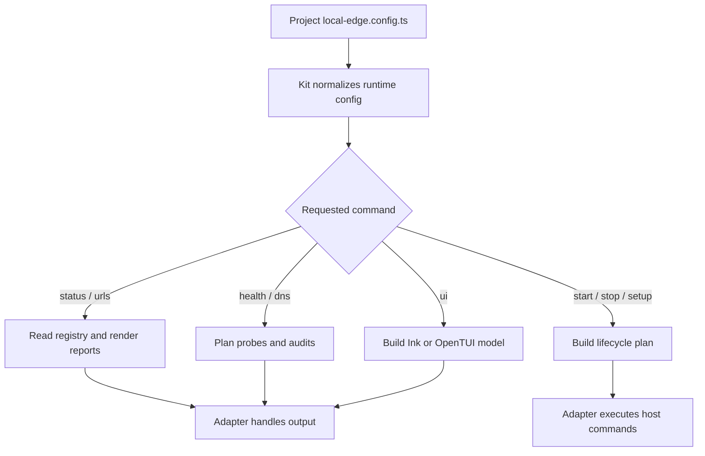

# @gg-utils/local-edge-kit

Reusable command framework for repositories that define their own `local-edge.config.ts`.

The kit composes `@gg-utils/local-edge-core` primitives into config-driven CLI runners, status
commands, URL matrix commands, health checks, DNS audits, runtime launch planning, lifecycle plans,
helper-dashboard servers, and Ink/OpenTUI action browser models. The consuming repository owns
surface IDs, route labels, process commands, env overlays, prompts, and host mutations.

## Install

```bash
npm install @gg-utils/local-edge-kit@git+https://github.com/gg-utils/local-edge-kit.git#v0.4.1
```

Pinned dependency example:

```json
{
  "dependencies": {
    "@gg-utils/local-edge-kit": "git+https://github.com/gg-utils/local-edge-kit.git#v0.4.1"
  }
}
```

## When To Use

- You are building a local-edge CLI around a project-owned config object.
- You need reusable status, healthcheck, DNS audit, URL, log, or lifecycle command logic.
- You need Ink/OpenTUI UI models but want project copy and command names outside the package.
- You need shell runners that delegate to explicit package-owned lifecycle logic.

Skip this package for low-level hostname, manifest, TLS, or registry helpers; use
`@gg-utils/local-edge-core` directly.

## Public Surfaces

| Import | Purpose |
|---|---|
| `@gg-utils/local-edge-kit/cli` | Config-bound CLI dispatcher. |
| `@gg-utils/local-edge-kit/config` | Kit config contracts. |
| `@gg-utils/local-edge-kit/runtime-config` | Runtime config normalization. |
| `@gg-utils/local-edge-kit/status-cli` | Status command helpers. |
| `@gg-utils/local-edge-kit/healthcheck-cli` | Healthcheck command helpers. |
| `@gg-utils/local-edge-kit/dns-audit-cli` | DNS audit command helpers. |
| `@gg-utils/local-edge-kit/lifecycle-plans` | Start, stop, setup, doctor, and ensure-running plans. |
| `@gg-utils/local-edge-kit/runtime-launch` | Runtime launch URL and process planning. |
| `@gg-utils/local-edge-kit/ui-launcher` | Ink/OpenTUI launcher flag parsing. |
| `@gg-utils/local-edge-kit/shell/with-logs-runner.sh` | Shell runner export for adapter scripts. |

## Quick Start

```ts
import {
  LocalEdgeKit_runCli,
  type LocalEdgeKit_Config,
} from "@gg-utils/local-edge-kit";

declare const config: LocalEdgeKit_Config;

await LocalEdgeKit_runCli({
  args: ["status", "--json"],
  config,
});
```

## Operational Flow



## App Supervisor

`@gg-utils/local-edge-kit/supervisor-cli` runs a set of loopback apps from one command and
exposes them through a core exposure backend. Set `exposure.backend` to `ports` (the default:
one tailnet HTTPS port per app) or `hostnames` (one public name per app under one wildcard,
routed by SNI through a loopback nginx, configured by `exposure.hostnames`). `--backend=<name>` overrides the choice for one command.

```ts
import { LocalEdgeKit_runSupervisorCli } from "@gg-utils/local-edge-kit/supervisor-cli";

process.exitCode = await LocalEdgeKit_runSupervisorCli({ args: process.argv.slice(2), config });
```

Each app gives `cwd`, `command`, `args`, an env file and the env NAMES it needs, a loopback port,
an optional edge port, `healthPath`, optional `readyPath` and `readyLogLine`, pid and log files,
and `dependsOn`. `launchEnv` (values, or a function called only when the app is started) is set
over the supervisor's env for that process; it counts toward the required names and only its
names are printed. `external: true` marks a route-only app: it is listed, probed and routed, but
never started, stopped or signalled. `locations` adds extra path routes for the hostnames backend.

| Command | What it does |
|---|---|
| `status [--json]` | Process state, health and edge state per app. |
| `up [app...]` | Starts apps in dependency order and waits for health. Adopts a running app. |
| `down [app...]` | Stops dependants first: SIGTERM to the process group, SIGKILL after the timeout. |
| `health [app...]` | Probes the health and ready paths on `127.0.0.1`. |
| `logs <app> [-n N] [-f]` | Tails the app log. |
| `plan [--backend=<name>] [--remove]` | Prints exposure actions and changes nothing. |
| `expose` / `unexpose [--apply]` | Maps or removes edge URLs. Without `--apply` this is a dry run. |

When `up` starts an app it gives the process a random launch id in its environment
(`LOCAL_EDGE_KIT_LAUNCH_ID`) and writes the pid file with the process's identity: owner uid,
start time, command line and that launch id. `ps` shows start times to the second only; the
launch id tells apart a pid reused within the same second by the same user and command line.
It is read back from `/proc/<pid>/environ` on Linux and from `ps -E` on macOS. Where the
environment cannot be read (recent macOS shows none in `ps -E`), the check falls back to uid,
start time and command line, so same-second reuse there is not detected. An app is adopted only when its pid file names a live process whose
identity still matches and whose process tree holds the port, so a run started by an earlier
`up` is never started twice and a recycled pid is never adopted. A pid file without an identity
(written by another tool) is shown as `unverified`; such a process is never adopted or
signalled. `down` checks the identity again immediately before every signal. A port held by any
other process is reported as `port-busy`, and the supervisor never signals that process. The env
check reads names only and never returns or prints values. Pid files are written atomically
(temp file, fsync, rename) inside the app's `cwd`, and log files are opened without following
symlinks.

With the `hostnames` backend and `exposure.router` set, `up` also renders the nginx config from
the manifest. When it differs from the file on disk, a candidate file is checked with `nginx -t`
before it replaces the real one (an unchanged file that is not yet confirmed active is checked
too). A running nginx is then sent SIGHUP, or nginx is started when none runs (never without the
certificate and key). A delivered SIGHUP does not mean nginx took the new config, so the rendered
config carries a loopback-only marker: a server on the unix socket
`<folder of nginx.pidPath>/confirm.sock` (or `router.confirm.socketPath`) that answers
`/local-edge-config` with the SHA-256 of the render. After the signal or start, `up` polls it
(`router.confirm.timeoutMs`, default 5 s) and records the config as active only once it answers
the new hash. If the reload or start fails or is not confirmed, the previous config bytes are put
back (a config this run created is removed), an nginx this run started is stopped with SIGQUIT,
and nothing is recorded as active, so the next `up` tries again. Each rollback step (stop, record
not active, restore or remove the config) runs even when an earlier one failed, and the failures are
listed in the failed result's `errors`; a host call that throws while the config may already be
replaced (clearing the old marker socket, polling the marker, reading the new pid) is rolled back the
same way and listed there too, so `up` returns a result instead of throwing. If such a throw lands after nginx was started but before its pid could be verified, `up` tries once more to identify it and stops it; when it still cannot, the result says an nginx started by this run may still be running (with its pid when known) and what to check, and nothing is signalled. If nginx confirmed the new config but its state file cannot
be written, nothing is rolled back: nginx keeps running the confirmed config, the file stays in
place, `up` reports a failure that says so, and the next `up` reloads it and records the state. The router counts as ours only when
the pid in nginx's pid file matches the identity recorded in `<stateRoot>/router.state.json`, or
is an `nginx: master process` of our user whose single `-c` value is the same file as this config
after resolving symlinks on both sides (a longer name, a prefix or a suffix never matches); any
other process there is `unverified` and is never signalled or replaced. `down` sends SIGQUIT, checking the
identity again right before the signal; if nginx quit but its state file cannot be removed, `down` still
returns `ok: true` (action `stopped`) with the error in `errors`, and the next `up` starts nginx normally. `status` adds a `router` row with the nginx pid and the
Serve raw-TCP mapping in front of it (`exposed`, `missing` or `conflict`). The Serve mapping itself
is never changed by the supervisor.

`up` and `down` hold a per-app lock (`<pidFile>.lock`) while they inspect, start or stop and
publish the pid file, so two supervisors cannot start the same app twice. A lock file appears
only complete (temp file, then `link`). A lock left by a process that is gone is taken over
under a guard that removes only that exact stale lock, so a successor's lock is never removed.
An empty or partial lock (an older version may still be writing it) is never removed
automatically: remove it by hand once no supervisor runs. Pid, lock and log files must sit inside the app's `cwd`.
They are written without following symlinks: folders are walked one level at a time and checked
again after the open and before the rename, pid files are replaced atomically, and new files are
`0600` and new folders `0700`. The `cwd` and its ancestors are trusted; folders below it must
not be writable by other users (see `safe-write.ts` for the remaining window).

## CLI

The package exposes a `local-edge-kit` bin for script adapters that can execute TypeScript source
directly:

```bash
npx @gg-utils/local-edge-kit@git+https://github.com/gg-utils/local-edge-kit.git#v0.4.1 local-edge-kit --help
```

Most consumers should create a small repo-local executable that imports `LocalEdgeKit_runCli` and
passes the project config.

## Development

```bash
git clone https://github.com/gg-utils/local-edge-kit.git
cd local-edge-kit
npm run type-check
npm test
```

Run `npm ci --ignore-scripts` before development checks.

## Layout

```text
.
|-- shell/                   # Exported shell runner helpers
|-- src/cli.ts               # Config-bound CLI dispatcher
|-- src/config.ts            # Config contracts
|-- src/lifecycle-plans.ts   # Start/stop/setup/doctor planning
|-- src/runtime-launch.ts    # Runtime URL/process plans
|-- src/*-cli.ts             # Command-specific CLI helpers
|-- dist/
`-- package.json
```

## Caveats

- The kit plans and validates; adapters still own side effects and host-specific execution.
- Project-specific URLs, labels, env names, route catalogs, and process commands must come from config.
- The package depends on `@gg-utils/local-edge-core` and `@gg-utils/platform-logs-core`.

## Use from another repository

Requires Node `>=22.0.0 <27`. Add this dependency; built JavaScript and declarations are included, with no install build step:

```json
"@gg-utils/local-edge-kit": "git+https://github.com/gg-utils/local-edge-kit.git#v0.4.1"
```

The `local-edge-kit` binary intentionally exits with code 2 and asks for a repository adapter. It does not load config or start a service. Create `scripts/local-edge.js`:

```js
import { LocalEdgeKit_runCli } from '@gg-utils/local-edge-kit/cli';
import { config } from '../local-edge.config.js';
process.exitCode = await LocalEdgeKit_runCli({ args: process.argv.slice(2), config });
```

Run `node scripts/local-edge.js status` (also `urls`, `healthcheck`, `dns-audit`). Supply `LocalEdgeKit_Config`, normally authored with `defineLocalEdgeConfig`: required `identity`, `router` and `surfaces`; optional command-specific env names, paths and lifecycle/runtime-launch settings. There is no implicit config discovery. These commands do not start an HTTP listener. To launch repository processes, a repository adapter explicitly calls `LocalEdgeKit_runRuntimeLaunchPipeline` with its runtime-launch config and implementation callbacks, or `LocalEdgeKit_runStartupCliCommand` with configured implementation scripts. Their commands, upstream ports, router ports and exposure addresses are defined by that repository's configuration.

The optional helper HTTP APIs do start listeners. For example `scripts/dashboard.js` can contain:

```js
import { LocalEdgeKit_startHelperDashboardServer } from '@gg-utils/local-edge-kit/helper-dashboard-server';
LocalEdgeKit_startHelperDashboardServer({
  autoOpen: false, bindHost: '127.0.0.1', port: 9100,
  htmlPath: new URL('../dashboard/index.html', import.meta.url).pathname,
  htmlTransform: html => html, openCommand: 'open',
  startupLines: [], subdomainUrl: 'http://127.0.0.1:9100/', surfaceId: 'dashboard',
});
```

Run `node scripts/dashboard.js`. This example binds loopback port 9100. `port` is required; **`bindHost` is optional and defaults to `127.0.0.1`**, so the server never listens on every interface unless you ask for it. Passing `0.0.0.0` or `::` binds beyond loopback. The dashboard serves the configured HTML file for non-API paths, `/api/status` JSON, and optionally one configured JSON artifact endpoint. It is not a directory browser.

`LocalEdgeKit_startLogsWebServer` from `logs-web-server` likewise requires `port` and defaults `bindHost` to `127.0.0.1`, and takes `htmlPath`, `logDirectory`, `defaultScope`, `sourceDefinitions`, `surfaceId`, `startupLines`, and a `createWebSocketServer(server)` adapter. It serves the configured HTML at `/` and `/index.html`, health JSON at `/health`, and configured log data over the supplied WebSocket implementation. Its handle exposes `close()`. The package does not supply HTML assets, a WebSocket implementation, or a default port. A consumer can choose non-loopback binding by passing `bindHost`; neither server starts merely by importing this package.

Both servers check every request, and the logs server also checks every WebSocket upgrade, and answer `403` when a check fails:

- The `Host` header must be `localhost`, `127.0.0.1`, `[::1]` or the configured `bindHost`, on the listening port. A wildcard `bindHost` (`0.0.0.0`, `::`) is never a valid `Host`. This stops DNS rebinding.
- An `Origin` header, when present, must be the origin of that same `Host`. This stops other sites open in the same browser from reading data or opening the log stream.
- A server reached under another name, for example through the edge router, must list that name in `allowedHosts`, written as the browser sends it (`logs.dev.example.test` or `logs.dev.example.test:8443`). The dashboard also accepts the host of its `subdomainUrl`. Port resolver helpers also require a consumer-supplied `defaultPort`, env names and flags.
