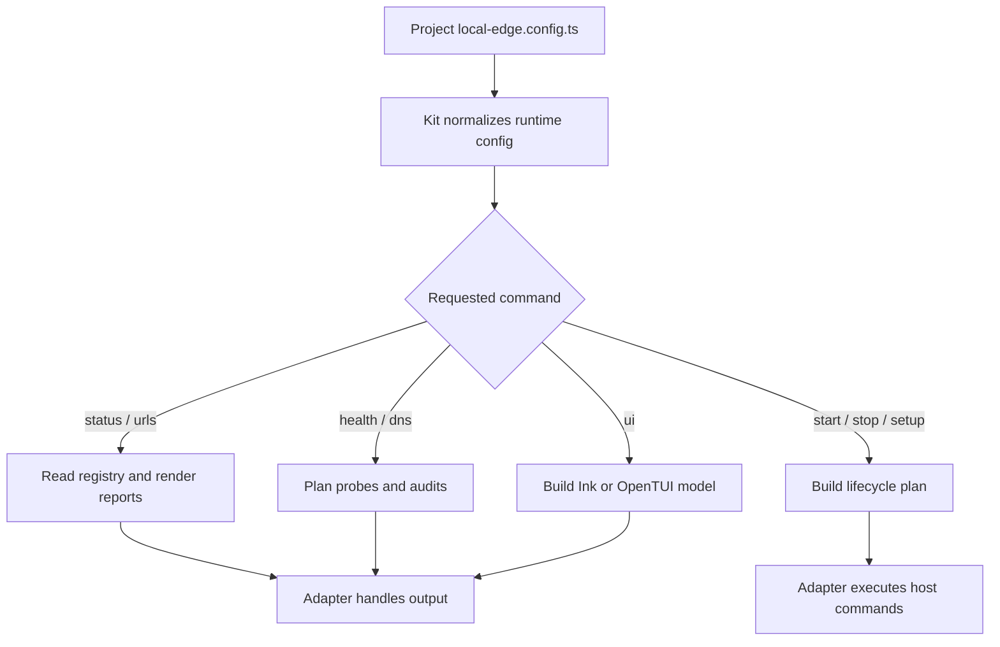

# @gg-utils/local-edge-kit

Reusable command framework for repositories that define their own `local-edge.config.ts`.

The kit composes `@gg-utils/local-edge-core` primitives into config-driven CLI runners, status
commands, URL matrix commands, health checks, DNS audits, runtime launch planning, lifecycle plans,
helper-dashboard servers, and Ink/OpenTUI action browser models. The consuming repository owns
surface IDs, route labels, process commands, env overlays, prompts, and host mutations.

## Install

```bash
npm install @gg-utils/local-edge-kit@git+https://github.com/gg-utils/local-edge-kit.git#main
```

Pinned dependency example:

```json
{
  "dependencies": {
    "@gg-utils/local-edge-kit": "git+https://github.com/gg-utils/local-edge-kit.git#a5b912b"
  }
}
```

## When To Use

- You are building a local-edge CLI around a project-owned config object.
- You need reusable status, healthcheck, DNS audit, URL, log, or lifecycle command logic.
- You need Ink/OpenTUI UI models but want project copy and command names outside the package.
- You need shell runners that delegate to explicit package-owned lifecycle logic.

Skip this package for low-level hostname, manifest, TLS, or registry helpers; use
`@gg-utils/local-edge-core` directly.

## Public Surfaces

| Import | Purpose |
|---|---|
| `@gg-utils/local-edge-kit/cli` | Config-bound CLI dispatcher. |
| `@gg-utils/local-edge-kit/config` | Kit config contracts. |
| `@gg-utils/local-edge-kit/runtime-config` | Runtime config normalization. |
| `@gg-utils/local-edge-kit/status-cli` | Status command helpers. |
| `@gg-utils/local-edge-kit/healthcheck-cli` | Healthcheck command helpers. |
| `@gg-utils/local-edge-kit/dns-audit-cli` | DNS audit command helpers. |
| `@gg-utils/local-edge-kit/lifecycle-plans` | Start, stop, setup, doctor, and ensure-running plans. |
| `@gg-utils/local-edge-kit/runtime-launch` | Runtime launch URL and process planning. |
| `@gg-utils/local-edge-kit/ui-launcher` | Ink/OpenTUI launcher flag parsing. |
| `@gg-utils/local-edge-kit/shell/with-logs-runner.sh` | Shell runner export for adapter scripts. |

## Quick Start

```ts
import {
  LocalEdgeKit_runCli,
  type LocalEdgeKit_Config,
} from "@gg-utils/local-edge-kit";

declare const config: LocalEdgeKit_Config;

await LocalEdgeKit_runCli({
  args: ["status", "--json"],
  config,
});
```

## Operational Flow



## CLI

The package exposes a `local-edge-kit` bin for script adapters that can execute TypeScript source
directly:

```bash
npx @gg-utils/local-edge-kit@git+https://github.com/gg-utils/local-edge-kit.git#main local-edge-kit --help
```

Most consumers should create a small repo-local executable that imports `LocalEdgeKit_runCli` and
passes the project config.

## Development

```bash
git clone https://github.com/gg-utils/local-edge-kit.git
cd local-edge-kit
npm run type-check
npm test
```

Scripts currently expect the source-first workspace toolchain.

## Layout

```text
.
|-- shell/                   # Exported shell runner helpers
|-- src/cli.ts               # Config-bound CLI dispatcher
|-- src/config.ts            # Config contracts
|-- src/lifecycle-plans.ts   # Start/stop/setup/doctor planning
|-- src/runtime-launch.ts    # Runtime URL/process plans
|-- src/*-cli.ts             # Command-specific CLI helpers
|-- dist/
`-- package.json
```

## Caveats

- The kit plans and validates; adapters still own side effects and host-specific execution.
- Project-specific URLs, labels, env names, route catalogs, and process commands must come from config.
- The package depends on `@gg-utils/local-edge-core` and `@gg-utils/platform-logs-core`.
