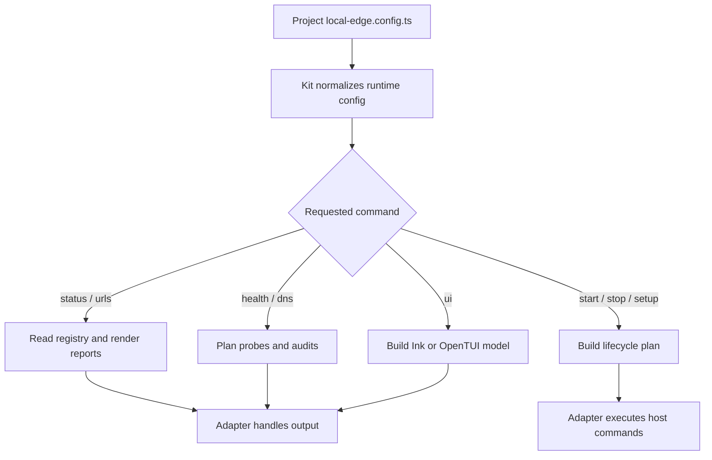

# @gg-utils/local-edge-kit

Reusable command framework for repositories that define their own `local-edge.config.ts`.

The kit composes `@gg-utils/local-edge-core` primitives into config-driven CLI runners, status
commands, URL matrix commands, health checks, DNS audits, runtime launch planning, lifecycle plans,
helper-dashboard servers, and Ink/OpenTUI action browser models. The consuming repository owns
surface IDs, route labels, process commands, env overlays, prompts, and host mutations.

## Install

```bash
npm install @gg-utils/local-edge-kit@git+https://github.com/gg-utils/local-edge-kit.git#main
```

Pinned dependency example:

```json
{
  "dependencies": {
    "@gg-utils/local-edge-kit": "git+https://github.com/gg-utils/local-edge-kit.git#a5b912b"
  }
}
```

## When To Use

- You are building a local-edge CLI around a project-owned config object.
- You need reusable status, healthcheck, DNS audit, URL, log, or lifecycle command logic.
- You need Ink/OpenTUI UI models but want project copy and command names outside the package.
- You need shell runners that delegate to explicit package-owned lifecycle logic.

Skip this package for low-level hostname, manifest, TLS, or registry helpers; use
`@gg-utils/local-edge-core` directly.

## Public Surfaces

| Import | Purpose |
|---|---|
| `@gg-utils/local-edge-kit/cli` | Config-bound CLI dispatcher. |
| `@gg-utils/local-edge-kit/config` | Kit config contracts. |
| `@gg-utils/local-edge-kit/runtime-config` | Runtime config normalization. |
| `@gg-utils/local-edge-kit/status-cli` | Status command helpers. |
| `@gg-utils/local-edge-kit/healthcheck-cli` | Healthcheck command helpers. |
| `@gg-utils/local-edge-kit/dns-audit-cli` | DNS audit command helpers. |
| `@gg-utils/local-edge-kit/lifecycle-plans` | Start, stop, setup, doctor, and ensure-running plans. |
| `@gg-utils/local-edge-kit/runtime-launch` | Runtime launch URL and process planning. |
| `@gg-utils/local-edge-kit/ui-launcher` | Ink/OpenTUI launcher flag parsing. |
| `@gg-utils/local-edge-kit/shell/with-logs-runner.sh` | Shell runner export for adapter scripts. |

## Quick Start

```ts
import {
  LocalEdgeKit_runCli,
  type LocalEdgeKit_Config,
} from "@gg-utils/local-edge-kit";

declare const config: LocalEdgeKit_Config;

await LocalEdgeKit_runCli({
  args: ["status", "--json"],
  config,
});
```

## Operational Flow



## CLI

The package exposes a `local-edge-kit` bin for script adapters that can execute TypeScript source
directly:

```bash
npx @gg-utils/local-edge-kit@git+https://github.com/gg-utils/local-edge-kit.git#main local-edge-kit --help
```

Most consumers should create a small repo-local executable that imports `LocalEdgeKit_runCli` and
passes the project config.

## Development

```bash
git clone https://github.com/gg-utils/local-edge-kit.git
cd local-edge-kit
npm run type-check
npm test
```

Run `npm ci --ignore-scripts` before development checks.

## Layout

```text
.
|-- shell/                   # Exported shell runner helpers
|-- src/cli.ts               # Config-bound CLI dispatcher
|-- src/config.ts            # Config contracts
|-- src/lifecycle-plans.ts   # Start/stop/setup/doctor planning
|-- src/runtime-launch.ts    # Runtime URL/process plans
|-- src/*-cli.ts             # Command-specific CLI helpers
|-- dist/
`-- package.json
```

## Caveats

- The kit plans and validates; adapters still own side effects and host-specific execution.
- Project-specific URLs, labels, env names, route catalogs, and process commands must come from config.
- The package depends on `@gg-utils/local-edge-core` and `@gg-utils/platform-logs-core`.

## Use from another repository

Requires Node `>=22.0.0 <27`. Add this dependency; built JavaScript and declarations are included, with no install build step:

```json
"@gg-utils/local-edge-kit": "git+https://github.com/gg-utils/local-edge-kit.git#v0.2.0"
```

The `local-edge-kit` binary intentionally exits with code 2 and asks for a repository adapter. It does not load config or start a service. Create `scripts/local-edge.js`:

```js
import { LocalEdgeKit_runCli } from '@gg-utils/local-edge-kit/cli';
import { config } from '../local-edge.config.js';
process.exitCode = await LocalEdgeKit_runCli({ args: process.argv.slice(2), config });
```

Run `node scripts/local-edge.js status` (also `urls`, `healthcheck`, `dns-audit`). Supply `LocalEdgeKit_Config`, normally authored with `defineLocalEdgeConfig`: required `identity`, `router` and `surfaces`; optional command-specific env names, paths and lifecycle/runtime-launch settings. There is no implicit config discovery. These commands do not start an HTTP listener. To launch repository processes, a repository adapter explicitly calls `LocalEdgeKit_runRuntimeLaunchPipeline` with its runtime-launch config and implementation callbacks, or `LocalEdgeKit_runStartupCliCommand` with configured implementation scripts. Their commands, upstream ports, router ports and exposure addresses are defined by that repository's configuration.

The optional helper HTTP APIs do start listeners. For example `scripts/dashboard.js` can contain:

```js
import { LocalEdgeKit_startHelperDashboardServer } from '@gg-utils/local-edge-kit/helper-dashboard-server';
LocalEdgeKit_startHelperDashboardServer({
  autoOpen: false, bindHost: '127.0.0.1', port: 9100,
  htmlPath: new URL('../dashboard/index.html', import.meta.url).pathname,
  htmlTransform: html => html, openCommand: 'open',
  startupLines: [], subdomainUrl: 'http://127.0.0.1:9100/', surfaceId: 'dashboard',
});
```

Run `node scripts/dashboard.js`. This example binds loopback port 9100. `port` is required; **`bindHost` is optional and defaults to `127.0.0.1`**, so the server never listens on every interface unless you ask for it. Passing `0.0.0.0` or `::` binds beyond loopback. The dashboard serves the configured HTML file for non-API paths, `/api/status` JSON, and optionally one configured JSON artifact endpoint. It is not a directory browser.

`LocalEdgeKit_startLogsWebServer` from `logs-web-server` likewise requires `port` and defaults `bindHost` to `127.0.0.1`, and takes `htmlPath`, `logDirectory`, `defaultScope`, `sourceDefinitions`, `surfaceId`, `startupLines`, and a `createWebSocketServer(server)` adapter. It serves the configured HTML at `/` and `/index.html`, health JSON at `/health`, and configured log data over the supplied WebSocket implementation. Its handle exposes `close()`. The package does not supply HTML assets, a WebSocket implementation, or a default port. A consumer can choose non-loopback binding by passing `bindHost`; neither server starts merely by importing this package.

Both servers check every request, and the logs server also checks every WebSocket upgrade, and answer `403` when a check fails:

- The `Host` header must be `localhost`, `127.0.0.1`, `[::1]` or the configured `bindHost`, on the listening port. A wildcard `bindHost` (`0.0.0.0`, `::`) is never a valid `Host`. This stops DNS rebinding.
- An `Origin` header, when present, must be the origin of that same `Host`. This stops other sites open in the same browser from reading data or opening the log stream.
- A server reached under another name, for example through the edge router, must list that name in `allowedHosts`, written as the browser sends it (`logs.dev.example.test` or `logs.dev.example.test:8443`). The dashboard also accepts the host of its `subdomainUrl`. Port resolver helpers also require a consumer-supplied `defaultPort`, env names and flags.
